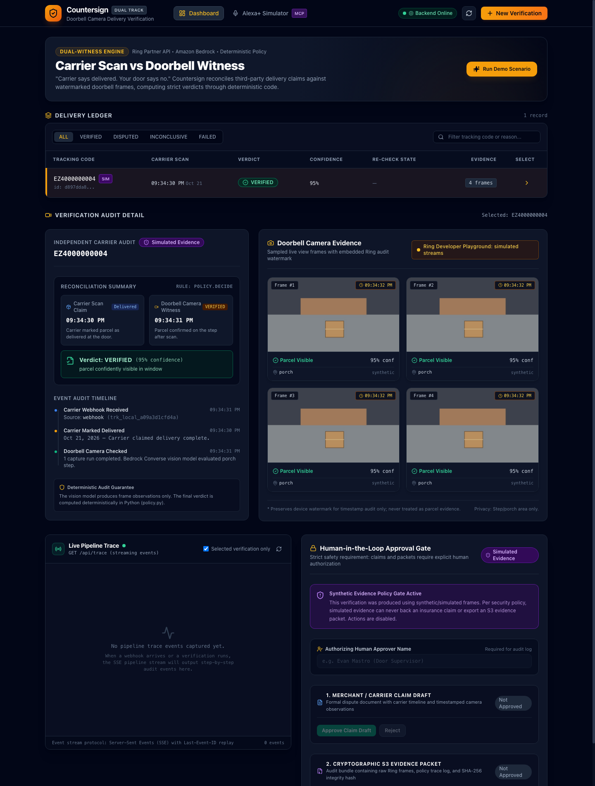
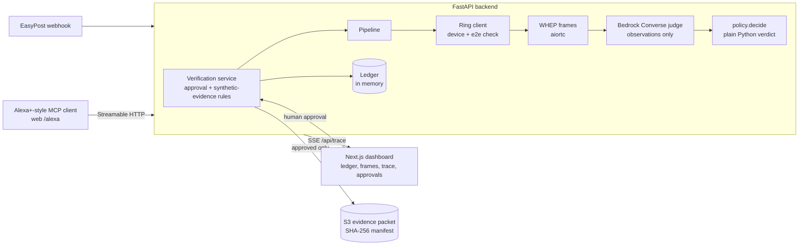
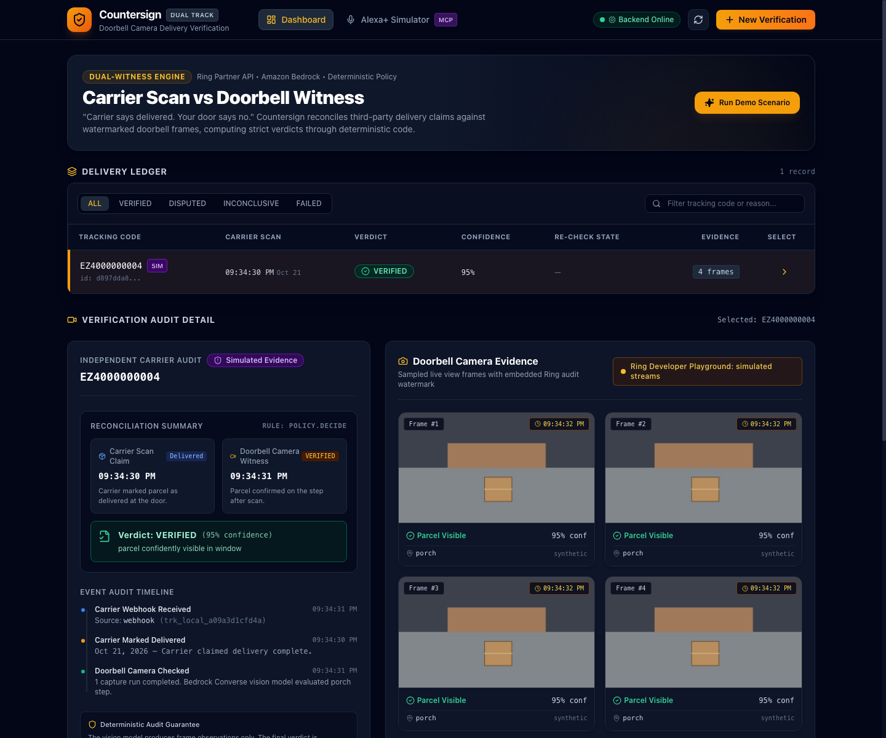
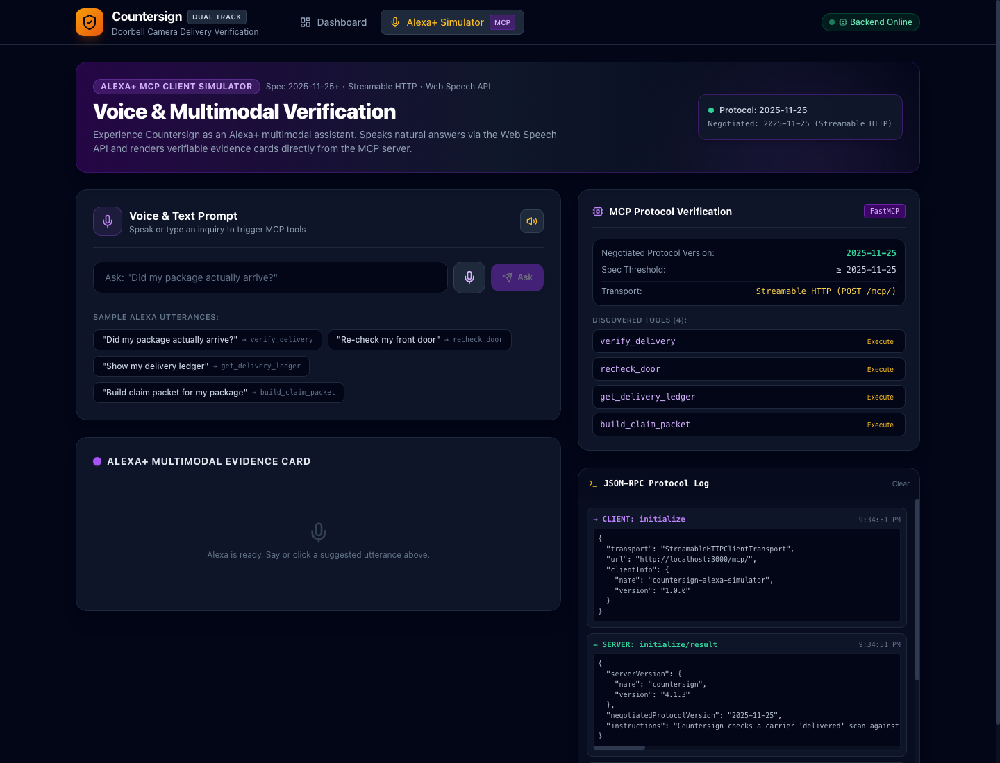

# Countersign

[](https://github.com/mastroevan/countersign/actions/workflows/ci.yml)

Verify a carrier's "delivered" scan against doorbell-camera evidence, with a
deterministic policy and a human in the loop. It started as an Amazon Developer Hackathon
project (Ring track, with an Alexa+-style MCP server) and is kept here as a portfolio piece.



## What it does
1. A carrier "delivered" event arrives (EasyPost webhook, a tracking-code lookup, or an
   MCP tool call).
2. The backend finds the door camera, refuses any device with `e2e_encryption.enabled`
   not explicitly `false`, opens a WHEP live-view session and samples frames.
3. Amazon Bedrock (Converse, forced tool use) reports **only** observations per frame:
   is a parcel visible, where, how confident, and the watermark time. It never decides.
4. `policy.py` turns observations into **VERIFIED / DISPUTED / INCONCLUSIVE** with plain
   Python. A DISPUTED verdict is provisional until a re-check runs.
5. Claim drafts and S3 evidence packets are built only after a named human approves them.

Design rules: the model never produces a verdict; no people, faces or vehicles are
described; the Ring watermark is preserved in evidence but is never evidence of a parcel;
synthetic frames can never back a claim.



## Try it in a few minutes, no accounts or credentials
Three terminals. The offline scenarios use a local stand-in tracker and synthetic frames
judged by a small pixel-reading stub instead of Bedrock, so nothing leaves your machine.

```bash
# 1. backend (Python 3.11+)
cd backend
python3.12 -m venv .venv && source .venv/bin/activate
pip install -e '.[dev]'
COUNTERSIGN_SCENARIOS=true RECHECK_DELAY_S=60 uvicorn countersign.main:app --port 8000

# 2. frontend (Node 20+), then open http://localhost:3000
cd web && npm install && npm run dev

# 3. drive it
cd backend && source .venv/bin/activate
python -m countersign.scenarios delivered_seen --offline      # -> VERIFIED
python -m countersign.scenarios delivered_not_seen --offline  # -> DISPUTED (provisional, re-check in 60 s)
python -m countersign.scenarios unreadable --offline          # -> INCONCLUSIVE
```
Each command prints the pipeline trace as it happens and exits non-zero if the verdict is
not the expected one. The same events stream to the dashboard's trace panel.



## What is real and what is staged
| Part | Offline demo | With credentials |
| --- | --- | --- |
| Webhook, policy, ledger, approvals, SSE trace, MCP tools, SHA-256 packets | real | real |
| Tracker | local stand-in | EasyPost test-mode tracker (written to their docs) |
| Camera frames | synthetic, never claimable | Ring Playground WHEP (written to their docs) |
| Frame judgment | pixel-reading stub | Amazon Bedrock Converse (set `BEDROCK_MODEL_ID`) |
| Tracker-to-stream wiring, scan time | staged and printed on screen | staged and printed on screen |

## Status (honest)
- Covered by 150+ automated tests, strict `mypy`, and a frontend typecheck and build, all run
  in CI. Ring, Bedrock, S3 and EasyPost are exercised through mocks and fakes in tests.
- **Not yet run end to end against live Ring, Bedrock, S3 or EasyPost.** The clients are
  written to the documented APIs; treat live behavior as unverified. See
  `docs/DEVLOG.md`, `docs/FRICTION.md` and `docs/PRODUCT_FEEDBACK.md`.
- The ledger is in memory (a restart loses data and pending timers). Routes are
  unauthenticated apart from the optional webhook HMAC, so run it locally only.
- Strands Agents and Bedrock AgentCore are not used.
- The vision judge has only been evaluated on synthetic frames
  (`python -m countersign.eval.run_eval --dry-run` only checks the harness).

## Stack
Python 3.11+, FastAPI, aiortc, boto3 (Bedrock Converse, S3), FastMCP (Streamable HTTP,
protocol 2025-11-25), Next.js 14 + Tailwind, `@modelcontextprotocol/sdk`.

## Configuration
Copy `.env.example` to `backend/.env` for live use. Variables: `RING_ACCESS_TOKEN`,
`RING_DEVICE_PACKAGE` / `RING_DEVICE_MOTION`, `BEDROCK_MODEL_ID`, `AWS_REGION`,
`COUNTERSIGN_DEVICE_TZ` (IANA zone of the camera's watermark), `EASYPOST_API_KEY` (test key),
`EASYPOST_WEBHOOK_SECRET` (enforces HMAC when set), `COUNTERSIGN_EVIDENCE_BUCKET`,
`RECHECK_DELAY_S` (600 default), `PUBLIC_BASE_URL`, `COUNTERSIGN_SCENARIOS=true` (enables the
demo stream-binding endpoint; leave off otherwise), `COUNTERSIGN_OFFLINE_SIMULATION=true`
(synthetic frames; can never back a claim).

## Frontend
Pages: `/` ledger, split-screen audit view, live trace panel, approval controls; `/alexa`
an MCP client (voice in and out) that talks to the server below. Checks:
`cd web && npm run typecheck && npm run build`.



## MCP server
Tools at `/mcp/` (Streamable HTTP): `verify_delivery`, `recheck_door`,
`get_delivery_ledger`, `build_claim_packet`. There is deliberately no approval tool;
claims and packets need a human approval via `POST /verifications/{id}/approvals`.

## Live trace
`GET /api/trace` is a Server-Sent Events stream of pipeline stages (webhook, device
discovery, encryption check, WHEP session, sampled frames, Bedrock call with model ID /
request ID / latency, judgment, the policy rule that fired, re-check). Filter with
`?verification_id=`, resume with `Last-Event-ID`, or pass `follow=false` to replay history.
Events carry metadata only, never image bytes.

## Tests
```bash
cd backend && pytest tests/ && mypy countersign
```

## License
Apache-2.0.
